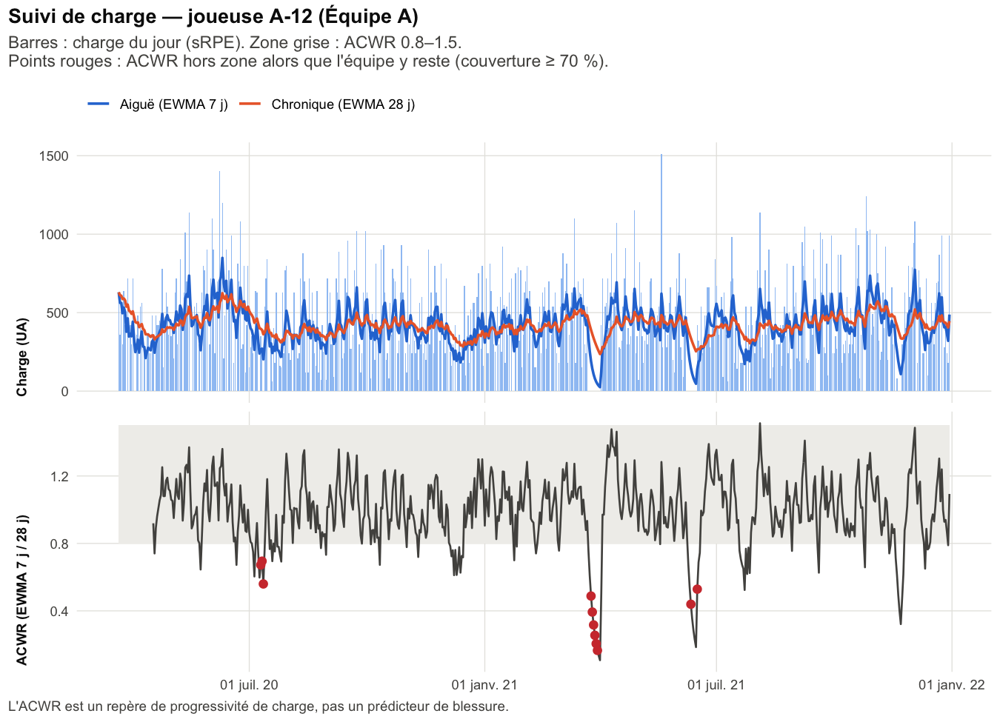
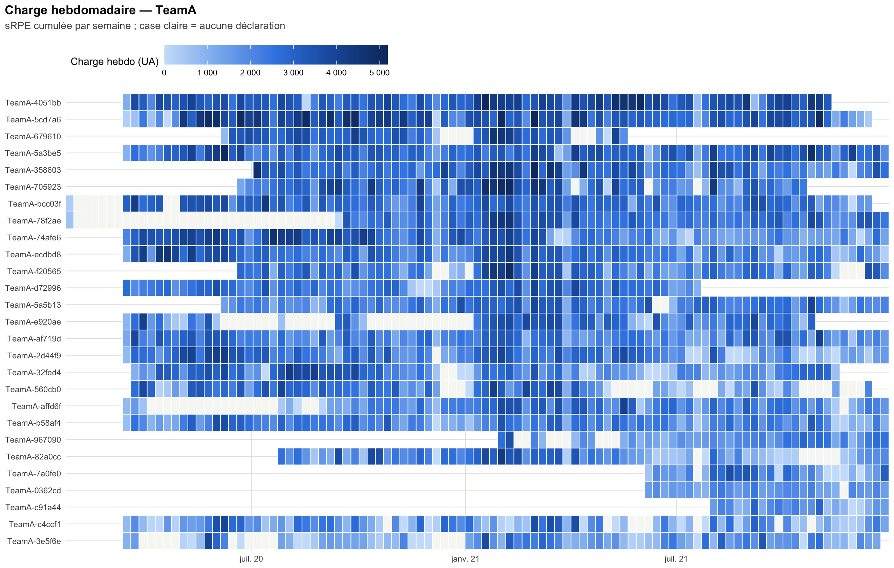
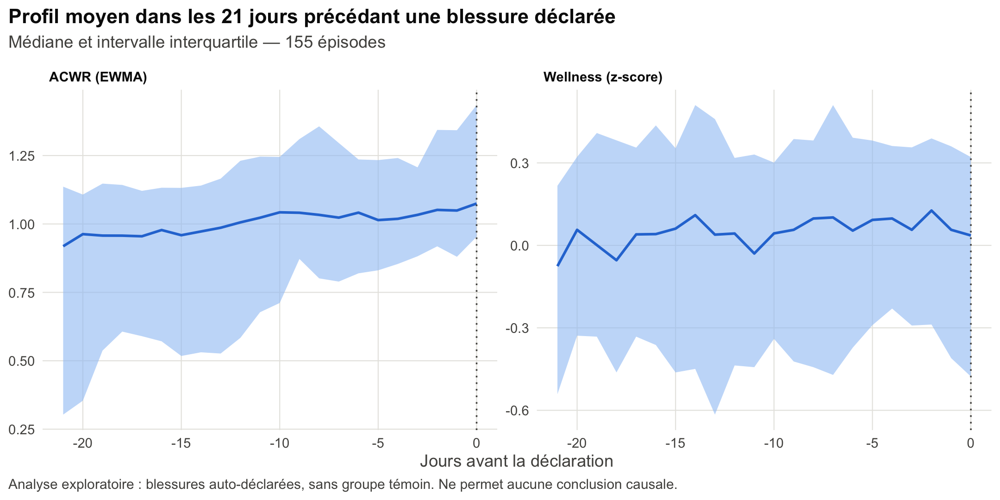
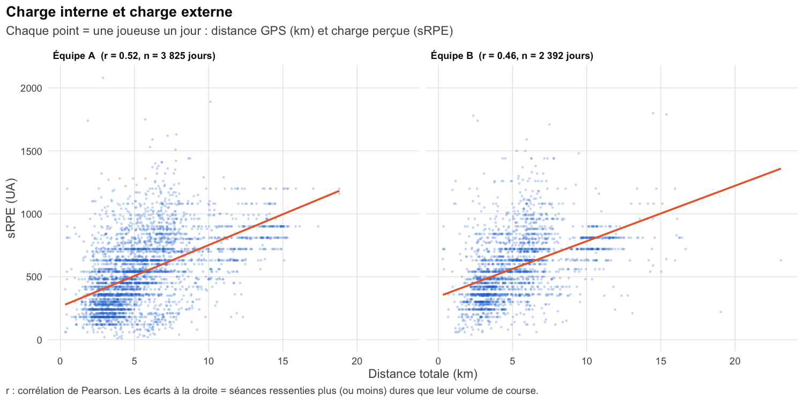
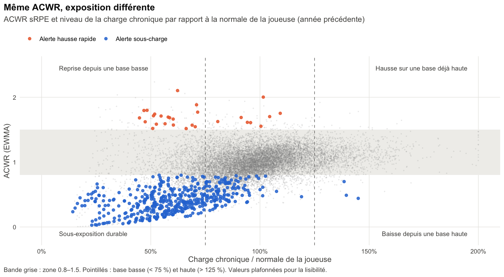
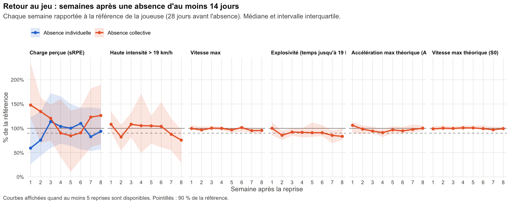
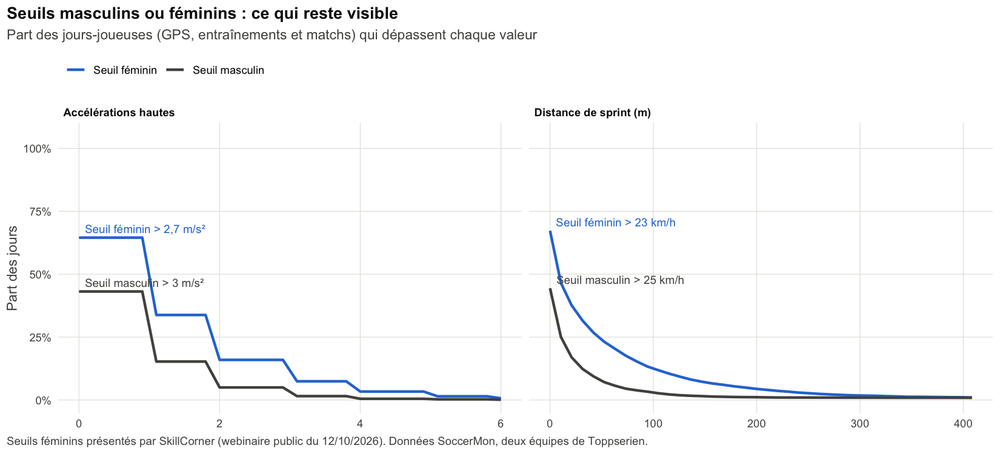

# Monitoring de la charge en football féminin d'élite

Pipeline R de **suivi de la charge interne et de l'état de forme** de joueuses, construit
sur le jeu de données ouvert [SoccerMon](https://www.nature.com/articles/s41597-024-03386-x)
(deux équipes féminines de première division norvégienne, saisons 2020–2021).

L'objectif est de reproduire le travail quotidien d'un sport scientist :
**vérifier la donnée → calculer les indicateurs → les rendre lisibles pour le staff →
poser une question de recherche appliquée.**

**[Ouvrir le tableau de bord interactif](https://julie-landrevie.github.io/womens-football-load-monitoring/)** : vue équipe, suivi individuel, qualité des données et piste de recherche, avec filtres par équipe et par période.



## Résultats sur SoccerMon (50 joueuses, 2 équipes, 2020–2021)

**1. Une limite du jeu de données repérée avant toute interprétation.**
Dans SoccerMon, un jour sans déclaration de charge vaut 0 : la charge n'est jamais
« manquante », et un repos est indiscernable d'un questionnaire non rempli. Le
pipeline restreint donc chaque joueuse à sa période active et ne déclenche une
alerte que si au moins 70 % des 28 derniers jours sont documentés (charge > 0 ou
wellness rempli). Sur la période active, la part médiane de jours avec une charge
> 0 est de 42 %, et la complétude médiane du wellness de 48 %.

**2. Des indicateurs validés.**
L'ACWR recalculé reproduit celui fourni dans SoccerMon (corrélation 1,00 ; 98 % des
21 490 jours-joueuses à moins de 0,1 d'écart). La méthode d'origine (moyennes
glissantes 7 j / 28 j, jours sans déclaration à 0) est ainsi confirmée.

**3. Des alertes qu'un staff peut réellement traiter.**
Appliqués tels quels, les seuils classiques déclenchaient une alerte sur près d'un
jour sur cinq, soit une centaine de jours par joueuse sur deux saisons : à ce
niveau, un staff ne lit plus les alertes (« fatigue d'alerte »). Trois règles,
ajoutées l'une après l'autre, les ramènent à des signaux individuels :

1. **Contexte équipe.** Lors d'une coupure ou d'une reprise planifiée, toute
   l'équipe sort de la zone d'ACWR en même temps. Une joueuse n'est signalée que si
   elle sort de la zone alors que la médiane de son équipe y reste, **avec un écart
   d'au moins 0,2** à cette médiane. Cette seule règle fait passer la part de jours
   en « sous-charge » de 19 % à 13 %.
2. **Persistance.** Une alerte de charge (ACWR, monotonie) n'apparaît qu'au
   **3ᵉ jour consécutif** hors zone : les oscillations d'un jour sont ignorées.
3. **Épisodes.** Des jours d'alerte consécutifs forment **un seul épisode**. Le
   tableau de bord affiche le nombre d'épisodes par joueuse, et le nombre de jours
   concernés au survol.

Sur les données SoccerMon, la part de jours en « sous-charge » passe de 13 % à
**3 % (équipe A) et 2 % (équipe B)**, la monotonie de 7 % à 3 % et de 3 % à 2 %,
et les hausses rapides deviennent rares (< 1 %). Il reste en médiane **13 à 16
épisodes d'alerte par joueuse et par an**, soit environ un toutes les trois à
quatre semaines : un volume qu'un staff peut examiner un par un. Les paramètres
sont réglables dans `R/00_config.R` (`team_margin`, `alert_persistence`).



**4. Piste de recherche : que se passe-t-il avant une blessure déclarée ?**
Sur 155 épisodes, l'ACWR médian augmente légèrement dans les 21 jours précédant
la déclaration (≈ 0,95 → 1,07) tout en restant dans la zone de référence, et le
wellness composite ne montre pas de baisse. **Dans ces données, le questionnaire
wellness ne semble pas anticiper les plaintes déclarées.** Résultat descriptif,
sans groupe témoin, sur des blessures auto-déclarées : il ne permet aucune
conclusion causale (voir *Limites*).



**5. Charge externe : ce que la joueuse a fait, et comment elle l'a vécu.**
Les 10 075 fichiers GPS (10 Hz, ~99 Go) ont été agrégés en 9 908 jours-joueuses
(86 séances trop courtes écartées, aucun fichier illisible). Valeurs médianes par
jour : ~4,8 km, ~95 m au-dessus de 19 km/h, 7 à 9 m de sprint au-dessus de 23 km/h (seuils féminins, cf. résultat 8),
vitesse maximale maintenue 1 s ~22,8 km/h. La charge perçue (sRPE) et la distance sont
**modérément corrélées (r = 0,52 et 0,46 selon l'équipe)** : à distance égale, une
séance peut être vécue très différemment, ce qui justifie de suivre les deux. Le nuage
de points fait aussi apparaître des bandes horizontales vers 10–15 km et 700–900 UA,
qui correspondent vraisemblablement aux matchs (≈ 90 min × RPE 8–10).



**6. Même ACWR, exposition différente : le ratio lu avec les valeurs absolues.**
Un ACWR de 0,78 dit seulement que la charge récente est 22 % sous la base
chronique. Il ne dit pas à quel niveau d'exposition cela se produit. Le pipeline
affiche donc, à côté de chaque ratio, la charge aiguë et chronique en valeur
absolue (UA/jour, mètres/jour) et le **niveau de la base** : charge chronique
rapportée à la normale de la joueuse (médiane de l'année précédente).

- Pour un ACWR sRPE autour de 0,8 (1 807 jours-joueuses entre 0,75 et 0,85), la
  charge aiguë va de **189 à 379 UA par jour** (10ᵉ–90ᵉ percentiles) : le même
  ratio recouvre des expositions qui varient du simple au double.
- **71 %** des jours d'alerte « hausse rapide » partent d'une base basse (< 75 % de
  la normale) : ce sont surtout des **reprises**, pas des surcharges. **74 %** des
  jours d'alerte « sous-charge » surviennent sur une base déjà basse : une
  **sous-exposition durable** plus qu'un creux passager. Chaque alerte porte
  désormais ce contexte (`outputs/tables/points_attention.csv`, colonne `contexte`).
- **ACWR de la charge externe** (haute intensité > 19 km/h, sprint > 23 km/h) : sur
  5 071 jours-joueuses où les deux ratios sont interprétables (44 joueuses), l'ACWR
  sRPE et l'ACWR de haute intensité sont faiblement corrélés (**r = 0,33**). Dans
  **94 %** des jours où l'ACWR de haute intensité dépasse 1,5, l'ACWR sRPE reste
  sous ce seuil : **la charge perçue seule ne voit pas ces pics de course à haute
  intensité.**

Dans le tableau de bord : tableau « Ratio et valeurs absolues » et choix de
l'indicateur (sRPE, haute intensité, sprint) dans la vue joueuse, graphique ratio /
niveau de base dans la vue équipe.



**7. Retour au jeu : comment une joueuse retrouve son niveau après une absence.**
Une absence est une période d'au moins 14 jours sans charge déclarée ni GPS. Elle
est *individuelle* si au moins la moitié de l'équipe s'entraîne pendant ce temps
(blessure, maladie, sélection…), *collective* sinon (intersaison, coupure). Chaque
semaine après la reprise est comparée aux 28 jours qui précèdent l'absence, la
référence propre de la joueuse.

- **34 absences individuelles** (médiane 27 jours, dont 6 avec une blessure
  déclarée) et 40 collectives. Après une absence individuelle, la charge perçue
  reprend progressivement : **59 % de la référence la 1ʳᵉ semaine, 76 % la 2ᵉ,
  retour au niveau d'avant la 3ᵉ** (médianes sur 26 reprises).
- Après une coupure collective, c'est l'inverse : **148 % de la charge d'avant
  la coupure dès la 1ʳᵉ semaine**, avec une vitesse maximale déjà à 100 %.
- **Les alertes d'ACWR se taisent au moment où elles seraient le plus utiles.**
  Dans les 4 semaines qui suivent une reprise individuelle, l'ACWR est masqué
  **73 % des jours** (trop peu de jours documentés sur 28 jours), alors que le
  ratio brut dépasse 1,5 sur 38 % des jours. Le suivi de reprise, comparé à la
  référence d'avant l'absence, prend le relais.
- **Point de méthode** : comparer le maximum d'une semaine au maximum des 4
  semaines de référence crée un faux déficit (plus de séances = maximum plus
  élevé). La référence de vitesse maximale est donc la médiane des maxima
  hebdomadaires. Sans cette correction, la vitesse paraissait plafonner à ~94 %
  après chaque coupure ; avec, elle est à ~100 % dès la 1ʳᵉ semaine.
- **Profil accélération-vitesse mesuré en séance** (Morin et al., 2021) : à partir
  des fichiers GPS bruts, accélération maximale atteinte par tranche de vitesse,
  puis droite ajustée → A0 (accélération maximale théorique) et S0 (vitesse
  maximale théorique), en gardant les deux accélérations les plus élevées par
  tranche de 0,2 m/s comme dans la méthode d'origine. Méthode validée sur des
  sprints simulés à profil connu (A0 et S0 retrouvés à 4 % près). Sur SoccerMon,
  à interpréter avec prudence : une accélération dérivée d'un GPS à 10 Hz reste
  bruitée, et les séances d'entraînement ne contiennent pas toujours d'effort maximal.

Limites : SoccerMon ne donne ni la cause des absences ni de diagnostic (aucune
rupture du LCA identifiable). Le GPS ne couvre qu'environ 60 % des séances :
seules 5 reprises individuelles ont assez de GPS pour suivre la vitesse maximale,
trop peu pour conclure sur ce point.



**8. Seuils féminins : ce que les seuils masculins font disparaître.**
Les métriques physiques reprennent souvent des seuils calibrés sur le football
masculin (sprint > 25 km/h, accélération haute > 3 m/s²). Le projet utilise
désormais des seuils calibrés sur le football féminin d'élite : course
13–19 km/h, haute intensité > 19 km/h, sprint > 23 km/h, accélération haute
> 2,7 m/s².

> **Source des seuils féminins.** Ils ont été présentés par SkillCorner lors du
> webinaire public « Women's Football: Dedicated Data, Smarter Decisions »
> (12 octobre 2026), dont la présentation a été transmise à toutes les personnes
> inscrites. SkillCorner les a validés en match, par tracking vidéo, sur
> 13 championnats féminins. Ce projet refait la même vérification, de façon
> indépendante, sur le GPS de SoccerMon.

SoccerMon couvre deux équipes de Toppserien (Norvège), l'un des championnats de
cette étude, mais en GPS et sur les entraînements comme sur les matchs. Sur
7 879 jours-joueuses (46 joueuses classées) :

| | Seuil masculin | Seuil féminin |
|---|---|---|
| Jours avec au moins un mètre de sprint | 44 % (> 25 km/h) | **67 %** (> 23 km/h) |
| Distance de sprint médiane par jour | 0 m | **7,8 m** |
| Jours avec au moins une accélération haute | 43 % (> 3 m/s²) | **65 %** (> 2,7 m/s²) |
| Accélérations hautes médianes par jour | 0 | **1** |

- **Couverture : le résultat de SkillCorner se retrouve.** Avec les seuils
  masculins, plus de la moitié des journées valent 0 en sprint et en
  accélérations hautes ; avec les seuils féminins, deux tiers des journées
  deviennent mesurables.
- **Classement des joueuses : peu de différence ici.** Le classement par
  accélérations hautes est presque identique avec les deux seuils (corrélation
  de rang 0,96), et aucune joueuse ne passe du quart inférieur à la moitié
  supérieure. SkillCorner travaille match par match, où les efforts rares valent
  souvent 0 ; ici, les moyennes portent sur des dizaines de jours par joueuse,
  ce qui lisse cet effet.
- **Stabilité** : même avec 20 jours par joueuse, le classement ne se reproduit
  pas d'un échantillon de jours à l'autre (corrélation < 0,8), avec les deux
  seuils. À l'entraînement, le volume de sprint dépend surtout du contenu de la
  séance, plus que de la joueuse.

Les seuils SoccerMon (16 et 20 km/h) et masculins restent calculés et exportés
pour comparaison (`outputs/tables/seuils_*.csv`).



## Ce que fait le pipeline

| Étape | Contenu | Fichier |
|---|---|---|
| Chargement | lecture des CSV SoccerMon (une colonne par joueuse), passage au format long, détection automatique des équipes | `R/01_load.R` |
| Contrôle qualité | complétude par joueuse et variable, valeurs hors bornes ou non numériques, doublons, cohérence entre l'ACWR fourni et l'ACWR recalculé | `R/02_quality.R` |
| Indicateurs | sRPE, charge aiguë/chronique (glissante et EWMA), ACWR, monotonie, strain, wellness en z-score individuel, points d'attention ; niveau de la base (chronique / normale de la joueuse), ACWR de course rapide et de sprint, contexte des alertes | `R/03_load_metrics.R` |
| Visualisation | vue qualité, vue équipe (charge hebdomadaire), vue joueuse (charge + ACWR, wellness), profil pré-blessure | `R/04_figures.R` |
| Rapport | rapport HTML autonome à destination du staff | `report/rapport_charge.Rmd` |
| Tableau de bord | export des données (`docs/data.js`) pour la page web interactive `docs/index.html`, publiée avec GitHub Pages | `R/05_dashboard.R` |
| Retour au jeu | absences d'au moins 14 jours (individuelles ou collectives), référence des 28 jours précédents, courbes de reprise semaine par semaine (sRPE, haute intensité, vitesse max, profil A-S) | `R/07_return.R` |
| Profil accélération-vitesse | accélération maximale par tranche de 0,2 m/s à partir du GPS brut, ajustement A0 / S0 (Morin et al., 2021) | `R/08_as_profile.R` (calculé par `run_gps.R`) |
| Seuils masculins / féminins | couverture, stabilité du classement des joueuses et profils cachés selon les seuils | `R/09_thresholds.R` |
| Charge externe (GPS) | lecture des ~10 000 fichiers GPS (un par joueuse et par jour), distance totale, bandes de vitesse SoccerMon, féminines et masculines, vitesse max maintenue 1 s, explosivité (temps jusqu'à 19 km/h), vitesse max, accélérations et décélérations > 2 m/s² | `R/06_gps.R`, `run_gps.R` |

Tous les seuils (fenêtres, zone d'ACWR, monotonie, seuil wellness, couverture
minimale) sont réglables dans `R/00_config.R`.

## Choix méthodologiques

- **Jours sans déclaration** : valent 0 dans SoccerMon. Analyse limitée à la
  période active de chaque joueuse ; un jour est « documenté » s'il a une charge > 0
  ou un wellness rempli ; **aucune alerte sous 70 % de jours documentés** sur 28 j.
- **Contexte équipe** : une alerte d'ACWR n'est émise que si la joueuse sort de la
  zone alors que la médiane de son équipe y reste, avec un écart d'au moins 0,2
  (pas d'alerte pendant une coupure ou une reprise collective).
- **Persistance et épisodes** : alerte de charge au 3ᵉ jour consécutif hors zone,
  et jours d'alerte consécutifs regroupés en un épisode, pour limiter la fatigue
  d'alerte. Le wellness reste un signal du jour (pas de persistance exigée).
- **Valeurs suspectes** : mises à NA pour le calcul, jamais corrigées en silence, et
  listées dans `outputs/tables/qc_valeurs_suspectes.csv`.
- **ACWR en EWMA** (Williams et al., 2017) plutôt qu'en moyennes glissantes seules,
  car il réagit moins aux pics isolés. Les deux versions sont calculées.
- **Wellness individualisé** : chaque item est comparé aux 28 jours *précédents* de la
  joueuse (sans le jour courant). Une joueuse qui note toujours 3/5 n'est pas
  comparée à une joueuse qui note toujours 5/5.
- **GPS : une ligne par instant.** Dans les fichiers SoccerMon, chaque instant GPS
  (10 Hz) est répété ~10 fois, car l'accéléromètre enregistre à 100 Hz sur des lignes
  séparées. Une seule ligne est gardée par instant, sinon les distances seraient
  multipliées par 10. La distance est intégrée avec le vrai pas de temps entre deux
  mesures ; les trous de signal de plus d'une seconde ne sont pas comblés et leur
  part est mesurée. Vitesses > 36 km/h écartées, vitesse max lissée sur 0,5 s.
- **Ratio et valeurs absolues** : la normale de la joueuse est la médiane de sa
  charge chronique sur les 365 jours *précédents* (jours interprétables, 28 au
  minimum). Base basse sous 75 %, haute au-dessus de 125 % (réglables).
- **ACWR GPS** : même EWMA 7 j / 28 j, en mètres par jour. Un jour sans GPS ni charge
  déclarée compte 0 m (repos) ; un jour sans GPS mais avec une charge > 0 est
  manquant (séance non captée) et ne met pas à jour la moyenne. Ratio interprétable
  seulement si au moins 70 % des jours actifs des 28 derniers jours ont un fichier
  GPS : le capteur n'est porté que sur ~60 % des séances déclarées.
- **Points d'attention, pas prédictions** : l'ACWR est débattu dans la littérature
  (Impellizzeri et al., 2020). Il sert ici de repère de progressivité de la charge.

## Lancer le projet

### 1. Prérequis
R ≥ 4.2 et les packages :
```r
install.packages(c("dplyr", "tidyr", "readr", "purrr", "stringr",
                   "ggplot2", "scales", "rmarkdown", "knitr", "jsonlite",
                   "arrow"))   # arrow : lecture des fichiers GPS (parquet)
```

### 2. Données
Télécharger **uniquement la partie subjective** de SoccerMon (environ 10 Mo ; la partie
GPS fait environ 92 Go) depuis Zenodo, DOI
[10.5281/zenodo.10033832](https://doi.org/10.5281/zenodo.10033832), puis décompresser
l'archive dans `data/raw/`. Le chargeur cherche les fichiers (`daily_load.csv`,
`fatigue.csv`, …) dans tous les sous-dossiers.

**GPS (facultatif).** Télécharger les 4 archives `objective-*.zip` (~99 Go), les
décompresser dans un dossier **en dehors du dépôt** (par ex. `~/Desktop/SoccerMon_GPS`),
puis lancer une seule fois :
```bash
Rscript run_gps.R ~/Desktop/SoccerMon_GPS
```
Le script lit chaque fichier une seule fois, en parallèle (10 à 30 min selon la
machine), peut être interrompu et relancé sans tout refaire, et écrit dans
`data/processed/` :
- `gps_daily.csv` : une ligne par joueuse et par jour, avec les seuils SoccerMon
  (16 / 20 km/h), féminins (13 / 19 / 23 km/h, 1,4 / 2,7 m/s²) et masculins
  (25 km/h, 3 m/s²), la vitesse max maintenue 1 s et l'explosivité ;
- `as_sessions.csv` : accélération maximale par tranche de vitesse et par séance
  (profil accélération-vitesse du module « Retour au jeu »).

Ces tables sont versionnées dans le dépôt : le reste du pipeline n'a plus besoin
des 99 Go.

### 3. Exécution
```bash
Rscript run_pipeline.R
# ou avec un autre dossier de données :
SOCCERMON_DIR=/chemin/vers/soccermon Rscript run_pipeline.R
```
Sorties : `outputs/rapport_charge.html`, `outputs/figures/`, `outputs/tables/`, et le
tableau de bord dans `docs/` (ouvrir `docs/index.html` dans un navigateur).

Les joueuses apparaissent sous des noms courts (A-01, B-01…) attribués par ordre
d'arrivée dans les données ; la correspondance avec les identifiants SoccerMon est
dans `outputs/tables/correspondance_joueuses.csv`.

### Tester sans les données
```bash
Rscript tests/make_test_data.R            # jeu SYNTHÉTIQUE au format SoccerMon
Rscript tests/make_test_gps.R             # GPS synthétiques (≈ 1,5 Go de CSV)
Rscript run_gps.R data/test_gps
SOCCERMON_DIR=data/test Rscript run_pipeline.R
```
Les résultats obtenus sur ce jeu de test n'ont aucune valeur sportive. Il sert
uniquement à vérifier que le code tourne.

## Limites et suites

- Blessures **auto-déclarées** (douleur mineure ou majeure), sans diagnostic médical.
- Analyse pré-blessure **descriptive**. Étape suivante : comparer avec des fenêtres
  sans blessure, avec un modèle mixte (effet aléatoire joueuse).
- GPS : la fréquence cardiaque enregistrée n'est pas exploitable (ceinture absente
  sur la plupart des séances) ; pas de distinction entraînement / match dans les
  fichiers.
- ACWR GPS calculé, mais **pas encore d'alerte** sur cet indicateur : seuils à
  définir avec le staff (risque de multiplier les alertes).
- Étape suivante : contexte du microcycle (J-1, J+1 du match) pour lire la charge
  selon le jour de la semaine, si les dates de match peuvent être identifiées.

## Références

- SkillCorner (2026). *Women's Football: Dedicated Data, Smarter Decisions*, webinaire public du 12 octobre 2026 (seuils de vitesse et d'accélération féminins).
- Morin J.-B. et al. (2021). In situ profiling of acceleration-speed. *Sports Biomechanics*.
- Midoglu C. et al. (2024). *A large-scale multivariate soccer athlete health, performance, and position monitoring dataset.* Scientific Data, 11, 553.
- Foster C. (1998). Monitoring training in athletes with reference to overtraining syndrome. *MSSE*.
- Foster C. et al. (2001). A new approach to monitoring exercise training. *JSCR*.
- Williams S. et al. (2017). Better way to determine the acute:chronic workload ratio? *BJSM*.
- Gabbett T. (2016). The training–injury prevention paradox. *BJSM*.
- Impellizzeri F. et al. (2020). Acute:chronic workload ratio: conceptual issues and fundamental pitfalls. *IJSPP*.

---
Julie Landrevie · [Portfolio](https://bit.ly/julie-landrevie-notion) · [LinkedIn](https://www.linkedin.com/in/julie-landrevie/)
